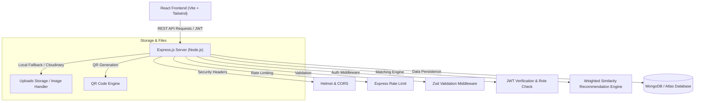
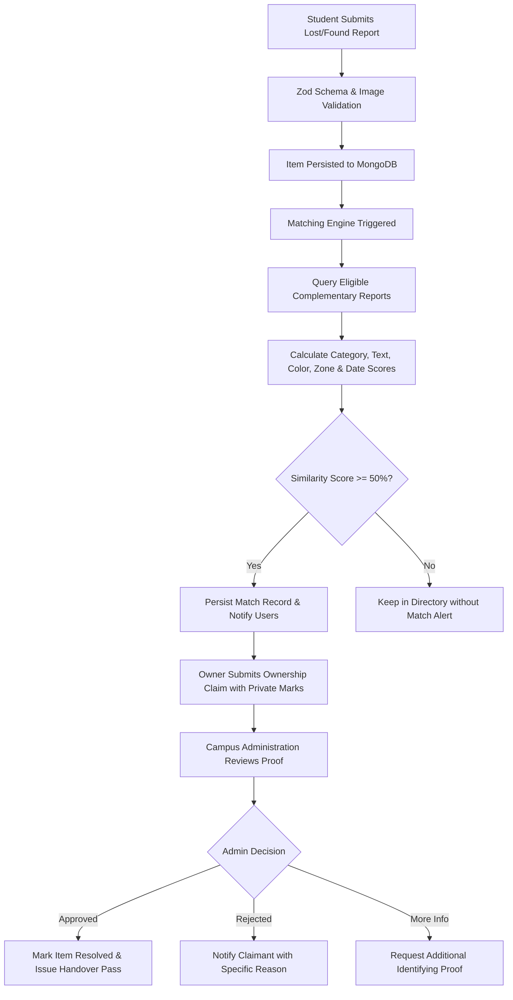

# FindIt — Smart Lost and Found

> **“Lost something? Find it smarter.”**  
> A centralized, privacy-conscious lost and found platform for college campuses featuring an explainable, weighted similarity-matching engine, role-based verification, and designated campus safe exchange hubs.

---

## 📌 1. Project Overview

### Problem Statement
College campuses witness hundreds of lost personal belongings every month—keys, student ID cards, wireless earbuds, water bottles, calculators, and notebooks. Traditional campus lost-and-found systems (scattered WhatsApp groups, physical pin-boards, informal word-of-mouth) are slow, noisy, and expose student phone numbers and private details to unverified parties.

### Solution
**FindIt** solves campus item loss through:
1. **Intelligent Similarity Matching:** Automatically pairs lost and found reports with explainable scores and human-readable reasoning without relying on expensive, black-box AI APIs.
2. **Privacy-by-Design:** Protects personal identity by concealing phone numbers, email addresses, and full ID numbers.
3. **Structured Ownership Verification:** Requires claimants to submit private proof (distinguishing marks, internal contents, purchase receipts) reviewed securely by campus administrators before handovers.
4. **Campus Safe Exchange Hubs:** Directs physical returns to monitored locations (Campus Security Gate, Library Helpdesk, Dean of Students Office).

---

## 🏗️ 2. Architecture & Tech Stack

### Technology Stack
- **Frontend:** React 19, Vite, Tailwind CSS, React Router v6, Lucide React, Axios, Canvas Confetti.
- **Backend:** Node.js, Express.js, REST API architecture.
- **Database:** MongoDB & Mongoose (with MongoDB Atlas support and automatic zero-dependency in-memory fallback for immediate local testing).
- **Security & Auth:** JWT authentication (HTTP-only cookies + Bearer token fallback), bcryptjs password hashing, Helmet, CORS, Rate Limiting, Zod input validation.
- **Quality & Testing:** Vitest, React Testing Library, Supertest.

### Architecture Diagram



### Matching & Claim Verification Flowchart



---

## 🧠 3. Explainable Similarity Matching Algorithm

Rather than relying on opaque cloud APIs, FindIt features an in-house, deterministic, and unit-tested recommendation algorithm.

### Scoring Breakdown (100% Total)

| Attribute | Weight | Method & Scoring Rules |
| :--- | :---: | :--- |
| **Title & Description** | **30%** | Tokenized Jaccard similarity after stop-word stripping and synonym normalization (`earbuds` ↔ `earphones`, `flask` ↔ `bottle`, `lanyard` ↔ `id_card`). |
| **Category Similarity** | **25%** | `1.0` for exact match; `0.45` for related categories (e.g. *Bags & Wallets* and *Accessories*); `0.0` for mismatch. |
| **Campus Zone Proximity** | **20%** | `1.0` for exact zone; `0.70` for adjacent campus zones (via zone adjacency matrix); `0.25` for other zones. |
| **Color Similarity** | **15%** | `1.0` for exact color; `0.85` for color synonyms (`dark` ↔ `black`, `silver` ↔ `gray`, `navy` ↔ `blue`); `0.40` for unknown/other. |
| **Date Proximity Decay** | **10%** | Temporal decay: `<=1 day`: 1.0; `<=3 days`: 0.85; `<=7 days`: 0.65; `<=14 days`: 0.45; `<=30 days`: 0.25; `>30 days`: 0.10. |

### Classification Tiers
- **High Similarity Match:** Score $\ge 75\%$
- **Possible Match Candidate:** Score $50\% - 74\%$
- **Low Similarity:** Score $< 50\%$ (not notified as an active match)

---

## 🌟 4. Hackathon Wow Factors

1. **Multilingual Interface:** Seamless instant toggle between **English**, **Hindi (हिन्दी)**, and **Marathi (मराठी)**.
2. **Campus Notice Board QR Generator:** One-click generation of printable QR code notices for campus bulletin boards containing public item references with zero private personal data.
3. **Private Ownership Proof Guard:** Claimants submit distinguishing marks (e.g. scratches, wallpaper, stickers) accessible only to authorized reviewers, preventing fraudulent claims.
4. **Safe Handover Protocol:** Built-in campus exchange point directory (Main Gate Booth, Library Helpdesk, Dean of Students) with safety checklists.
5. **Instant Demo Credentials:** 1-click login quick-fill for Admin, Aarav, Riya, and Ananya for rapid hackathon judge demonstrations.

---

## 🗄️ 5. Database Models

- **User:** Name, email, hashed password, role (`user` | `admin`), status (`active` | `suspended`), studentId, department.
- **Item:** Reporter ID, type (`lost` | `found`), title, category, description, color, campusZone, approximateLocation, date, images, status (`open` | `pending` | `resolved` | `archived`), qrCode.
- **Claim:** Item ID, Claimant ID, verificationAnswers (`distinguishingMarks`, `contentsOrDetails`, `additionalProof`), status (`pending` | `approved` | `rejected` | `more-info-needed`), adminReview notes.
- **Match:** lostItem ID, foundItem ID, similarityScore, scoreBreakdown, explanation, matchCategory.
- **Notification:** Recipient ID, type, title, message, item reference, isRead.
- **AuditLog:** Admin ID, action, targetResource, details, ipAddress.

---

## 🚀 6. API Endpoint Reference

| Method | Endpoint | Access | Description |
| :--- | :--- | :--- | :--- |
| `GET` | `/api/health` | Public | Service health & uptime check |
| `POST` | `/api/auth/register` | Public | Register new campus user |
| `POST` | `/api/auth/login` | Public | Login with email and password |
| `POST` | `/api/auth/logout` | Public | Clear authentication cookie |
| `GET` | `/api/auth/me` | Authenticated | Get current user profile and item counts |
| `GET` | `/api/items` | Public | Browse items with filtering, search & pagination |
| `GET` | `/api/items/:id` | Public | Get single item details & user claim context |
| `POST` | `/api/items` | Authenticated | Report new item (supports up to 4 photos) |
| `PATCH` | `/api/items/:id` | Authenticated | Update item report (reporter/admin only) |
| `DELETE` | `/api/items/:id` | Authenticated | Delete / withdraw item report |
| `GET` | `/api/items/:id/matches` | Public | Get similarity matches & algorithm breakdown |
| `POST` | `/api/claims` | Authenticated | Submit ownership verification claim |
| `GET` | `/api/claims/my` | Authenticated | View submitted claims & review statuses |
| `GET` | `/api/notifications` | Authenticated | Fetch persisted in-app alerts |
| `PATCH` | `/api/notifications/:id/read`| Authenticated | Mark notification as read |
| `GET` | `/api/admin/dashboard` | Admin Only | Get campus database statistics & recent audits |
| `GET` | `/api/admin/claims` | Admin Only | List all ownership claims for moderation |
| `PATCH` | `/api/admin/claims/:id/review`| Admin Only | Approve, reject, or request proof on claims |
| `GET` | `/api/admin/users` | Admin Only | List registered campus users |
| `PATCH` | `/api/admin/users/:id/status`| Admin Only | Suspend or activate a student account |
| `GET` | `/api/admin/audit-logs` | Admin Only | Review administrative security audit trail |

---

## 💻 7. Local Development Setup

### Prerequisites
- Node.js v18+ (tested on Node v24)
- npm v9+

### Step 1: Clone Repository
```bash
git clone https://github.com/your-username/findit.git
cd findit
```

### Step 2: Install Dependencies
```bash
# Install root, backend, and frontend packages
npm run install:all
```

### Step 3: Configure Environment Files
Create `server/.env`:
```env
PORT=5000
NODE_ENV=development
MONGODB_URI=memory
JWT_SECRET=supersecret_jwt_key_campus_lost_and_found_2026_dev
CLIENT_URL=http://localhost:5173
```
*(Setting `MONGODB_URI=memory` runs an embedded zero-dependency MongoDB instance for instant testing without requiring a local mongod daemon!)*

### Step 4: Populate Seed Demonstration Data
```bash
npm run seed
```

### Step 5: Start Frontend & Backend Concurrently
```bash
npm run dev
```
- Frontend: `http://localhost:5173`
- Backend API: `http://localhost:5000`
- API Health Check: `http://localhost:5000/api/health`

---

## 🔑 8. Pre-seeded Demo Credentials

For quick evaluation during hackathons and demonstrations:

| Role | Email | Password | Details |
| :--- | :--- | :--- | :--- |
| 👑 **Campus Admin** | `admin@campus.edu` | `AdminPass123!` | Access to Admin Center, Claims, Audits |
| 🎓 **Student 1 (Aarav)** | `aarav.sharma@campus.edu` | `StudentPass123!` | Has active lost earbuds & pending claim |
| 🎓 **Student 2 (Riya)** | `riya.patel@campus.edu` | `StudentPass123!` | Found earbuds, lost steel bottle |
| 🎓 **Student 3 (Ananya)** | `ananya.deshmukh@campus.edu`| `StudentPass123!` | Lost student ID card, found keys |

*(You can also use the 1-click Quick-Fill buttons on the Login page!)*

---

## 🧪 9. Automated Testing & Verification

Run the complete test suite from the root directory:
```bash
npm test
```

### Actual Test Execution Results
```
> findit-server@1.0.0 test
> vitest run
 ✓ src/tests/matchingEngine.test.js (11 tests) 13ms
 ✓ src/tests/api.test.js (7 tests) 99ms
 Test Files  2 passed (2)
      Tests  18 passed (18)

> client@1.0.0 test
> vitest run
 ✓ src/tests/ItemCard.test.jsx (1 test) 138ms
 ✓ src/tests/MatchCard.test.jsx (1 test) 147ms
 ✓ src/tests/HomePage.test.jsx (1 test) 143ms
 Test Files  3 passed (3)
      Tests  3 passed (3)

TOTAL: 21 tests passed (100% success rate, 0 failed)
```

Build production bundle:
```bash
npm run build
```
*(Builds static bundle to `client/dist` in ~6.5s).*

---

## 🌐 10. Deployment Guide (Render & MongoDB Atlas)

### 1. MongoDB Atlas Setup
1. Create a free M0 cluster on [MongoDB Atlas](https://www.mongodb.com/atlas).
2. Create a database user and whitelist IP `0.0.0.0/0` in Network Access.
3. Copy the connection string: `mongodb+srv://<user>:<password>@cluster0.mongodb.net/findit?retryWrites=true&w=majority`.

### 2. Backend Deployment (Render Web Service)
1. In Render, select **New Web Service** pointing to your repository.
2. Root Directory: `server`
3. Build Command: `npm install`
4. Start Command: `npm start`
5. Environment Variables:
   - `NODE_ENV`: `production`
   - `PORT`: `10000`
   - `MONGODB_URI`: `<Your MongoDB Atlas Connection String>`
   - `JWT_SECRET`: `<Generate strong 32-char secret>`
   - `CLIENT_URL`: `https://your-frontend-app.onrender.com`

### 3. Frontend Deployment (Render Static Site)
1. Select **New Static Site** pointing to your repository.
2. Root Directory: `client`
3. Build Command: `npm install && npm run build`
4. Publish Directory: `dist`
5. Environment Variables:
   - `VITE_API_URL`: `https://your-backend-api.onrender.com`
6. Add Rewrite Rule: Source: `/*` → Destination: `/index.html` (Status: 200) for React Router refresh support.

---

## 🛡️ 11. Security & Limitations

### Security Features
- Strict Zod validation on both client and server.
- Passwords hashed with bcrypt (salt rounds: 10).
- HTTP-Only SameSite cookie sessions and Bearer token fallback.
- Rate limiting on API, authentication, and reporting endpoints.
- Multer MIME-type and 5MB file-size limits.
- Tamper-evident AuditLog recorded for all administrative reviews.

### Known Limitations
- High-resolution multi-file image storage in local dev stores files in `server/uploads/`; production deployments should configure Cloudinary environment variables for permanent cloud CDN hosting.
- The similarity recommendation system operates on campus zones and text tokens; it intentionally avoids requiring continuous GPS permissions to preserve student privacy.

---

## 📄 License
This project is licensed under the MIT License. Built for university campus communities.
